# 🔧 Cutaway Lab

Step inside rockets, bodies, sports plays, and everyday machines. Every animated cutaway is a real **state machine** — kids step through how a thing works, and the app checks that every machine is sound (every step reachable, nothing gets stuck).

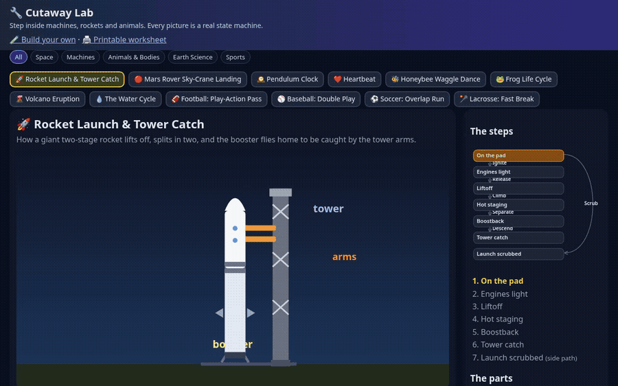

**36 machines · zero runtime deps · quizzes · narrated videos · formal TLC models · 711 unit / 60 e2e / 28 TLC**

## Quickstart (2 minutes)

```bash
git clone https://github.com/BoydVC/cutaway-lab && cd cutaway-lab
npm start            # http://127.0.0.1:4410  (no install needed)
npm test             # unit tests (node:test)
npm i && npx playwright install chromium && npm run e2e   # browser tests + screenshots
```

Topic chips above the picker (All · Space · Sports · …) filter the fleet.

Keys: **Space** play/pause · **→ / ←** step · **E** exploded view · **Q** quiz · **N** read aloud.

The sidebar draws the live statechart: current step glows, loops are dashed, click the next step to go there. Quiz stars save in the browser (Apprentice → Lab Scientist → Master Engineer).

Deep links: `#starship/staging`, `#clock/tickLeft/x` (`x` = exploded).

## Build your own + print a worksheet

- **`builder.html`**: write a machine as JSON; the checker flags stuck or unreachable steps. Share links put the machine in the URL (`#m=…`). Unsafe SVG is stripped.
- **`worksheet.html#<machine>`**: printable put-in-order + match-the-part + quiz. Answer key hidden when printed.

| | |
|---|---|
| 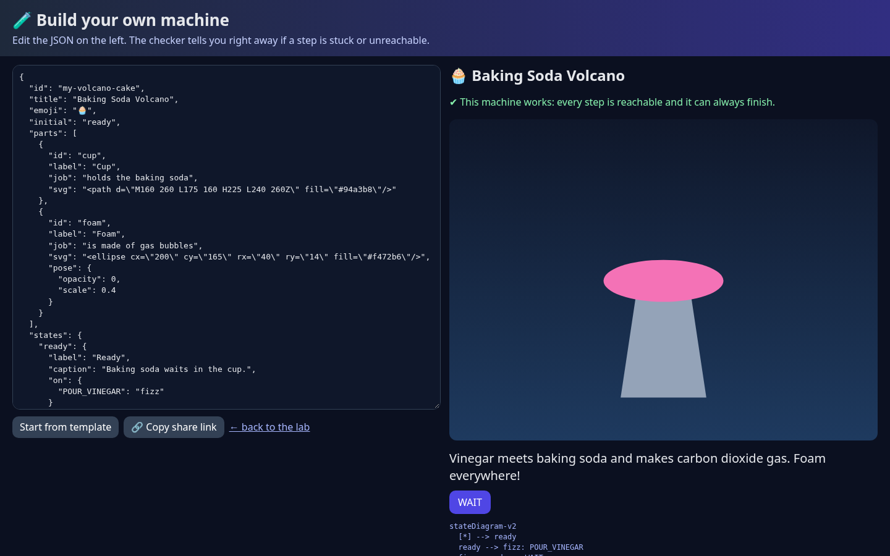 | 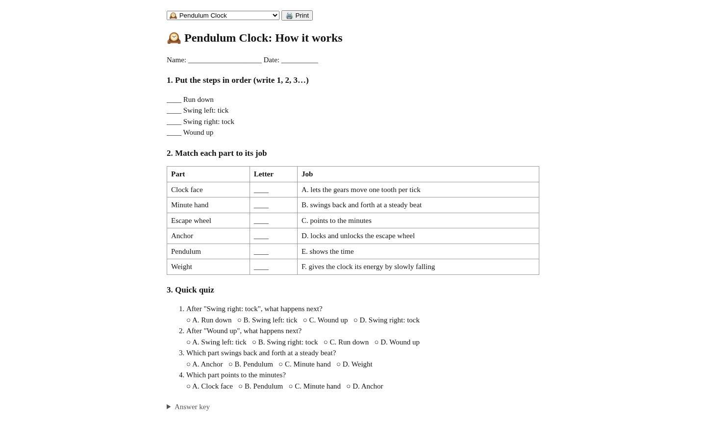 |

## Machine gallery (36)

| Machine | Main path | Side path |
|---|---|---|
| 🚀 Rocket Launch & Tower Catch | On the pad → Engines light → Liftoff → Hot staging → Boostback → Tower catch | Launch scrubbed |
| 🔴 Mars Rover Sky-Crane Landing | Hit the atmosphere → Parachute opens → Rocket descent → Sky crane lowers rover → Touchdown! | Pick a safer spot |
| 🕰️ Pendulum Clock | Wound up → Swing left: tick → Swing right: tock → Run down | — |
| ❤️ Heartbeat | Fill up → Top squeeze → Big squeeze | Rest of the story |
| 🐝 Honeybee Waggle Dance | Scout searches → Finds flowers → Waggle dance → Everyone goes | Back home |
| 🐸 Frog Life Cycle | Eggs → Tadpole → Growing legs → Froglet → Adult frog | Snack for a fish |
| 🌋 Volcano Eruption | Sleeping volcano → Magma rises → Eruption! → New land | Goes quiet |
| 💧 The Water Cycle | In the ocean → Evaporation → Condensation → Precipitation → Collection | — |
| 🏈 Football: Play-Action Pass | Huddle break → Snap → Play-action fake → Deep throw → Touchdown catch | Checkdown instead |
| ⚾ Baseball: Double Play | Pitch → Ground ball → Flip to second → Throw to first → Double play! | Everybody safe |
| ⚽ Soccer: Overlap Run | Build-up → Overlap run → Pass into space → Cut-back cross | Cut inside instead |
| 🥍 Lacrosse: Fast Break | Save! → Outlet clear → 4-on-3 push → Dish and finish | Reset the clear |
| 🏀 Basketball: Pick and Roll | Isolation set → Screen set → Turn the corner → Dish to the roll | Defense switches |
| 🏒 Hockey: Breakout | Retrieve → Tape-to-tape outlet → Exit the zone → Stretch pass | Chip off the glass |
| 🚲 Bicycle Drivetrain | Ready to pedal → Pedal push → Chain pulls → Wheel rolls | Chain slip |
| 🎾 Tennis: Kick Serve | Ready stance → Ball toss → Trophy pose → Racket drop → Brush-up contact | Toss fault |
| 🌱 Photosynthesis | Leaf at rest → Catch light → Sip water + air → Cook sugar | Stomata close |
| ⚙️ Gear Train | Gears at rest → Driver turns → Teeth mesh → Torque wins | Teeth skip |
| 🍎 Digestion Path | Bite + chew → Swallow → Stomach churn → Nutrients absorb | Wrong pipe! |
| 💡 Simple Circuit | Switch open → Switch closed → Current flows → Bulb lit | Short circuit |
| 🛗 Elevator Ride | Waiting → Doors closing → Moving up → Doors open | Doors reopen |
| 🚽 Toilet Flush | Tank ready → Flapper lifts → Siphon starts → Tank refills | Flapper stuck |
| 🚦 Traffic Light | Green — go → Yellow — slow → Red — stop | Skip to red |
| 🔒 Door Lock | Locked → Key in → Plug turns → Unlocked | Wrong key |
| 📷 Camera Shutter | Ready → Blades open → Exposing → Picture taken | Washed out |
| 🌡️ Thermostat | Watching → Call for heat → Heating → Setpoint reached | Sensor fault |
| 🧷 Zipper | Fully open → Teeth meshing → Halfway closed → Zipped shut | Fabric snag |
| ✏️ Pencil Sharpener | Empty → Pencil in → Shaving → Sharp point | Tip broken |
| 🪂 Parachute Landing | Freefall → Canopy deploys → Full canopy → Soft landing | Line tangle |
| 🌬️ Wind Turbine | Calm air → Cut-in speed → Blades spinning → Making power | Storm brake |
| 🧯 Fire Extinguisher | Ready → Pin pulled → Aimed at base → Sweeping spray | Tank empty |
| 🧵 Sewing Machine | Threaded → Needle down → Bobbin loop → Stitch locked | Thread jam |
| 🧭 Magnetic Compass | Settling → Points north → Taking a bearing | Skewed by metal |
| 🔦 Flashlight | Off → Switch closing → On → Off again | Batteries dead |
| ⛓️ Pulley | Ready → Lifting → Held high | Rope slipped |
| 🕯️ Candle | Unlit → Lighting → Burning → Snuffed | Drowned wick |

## What's inside

- `src/engine.js` — `validate`, `step`, `mainPath`, `pose`, `toMermaid`
- `src/layout.js` — live statechart layout
- `src/progress.js` — quiz stars + badges
- `src/quiz.js` — seeded quizzes from the machine itself
- `machines/*.js` — one plain-data file per machine
- `formal/` — TLA+ specs + TLC runner for sports and machines
- `narrations/*-captions.mp4` — Piper TTS walkthroughs

## Add a machine

```js
export default { id: 'volcano', title: 'Volcano', emoji: '🌋', initial: 'sleep',
  parts: [{ id: 'magma', label: 'Magma', job: 'pushes up from deep below',
    svg: '<circle cx="200" cy="250" r="30" fill="#f97316"/>', explode: [0, 30] }],
  states: {
    sleep: { label: 'Asleep', caption: '…', on: { RUMBLE: 'erupt' } },
    erupt: { label: 'Eruption', caption: '…', on: {}, parts: { magma: { y: -150 } } },
  },
};
```

Register it in `machines/index.js`, then `npm run check`.

See also [`docs/QUALITY.md`](docs/QUALITY.md) for the v1.0 visual/science pass.

## Screenshots

| | |
|---|---|
| 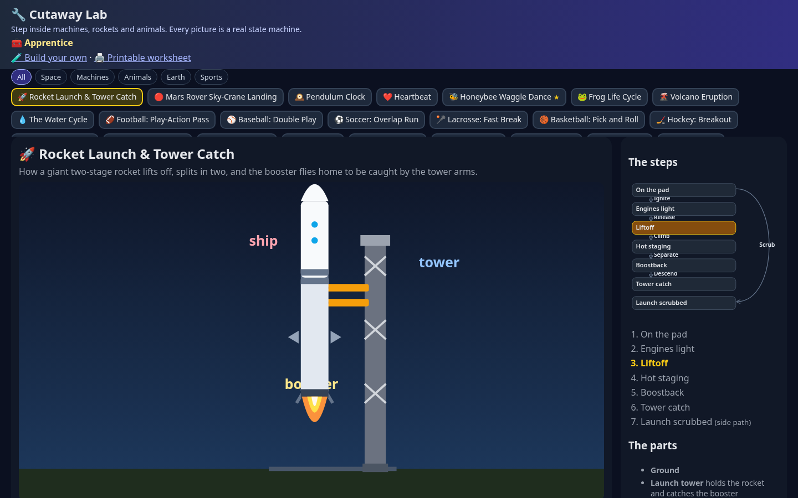 | 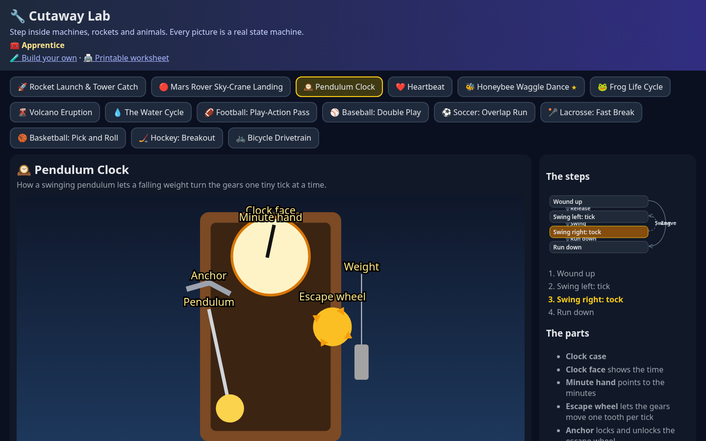 |
| 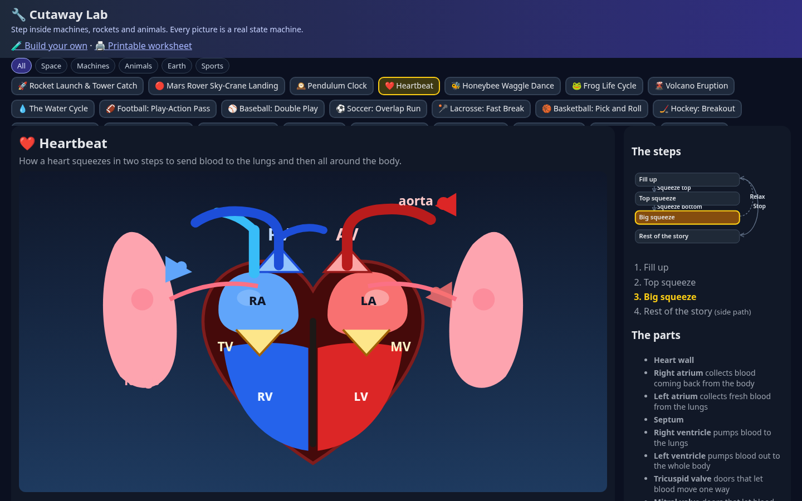 | 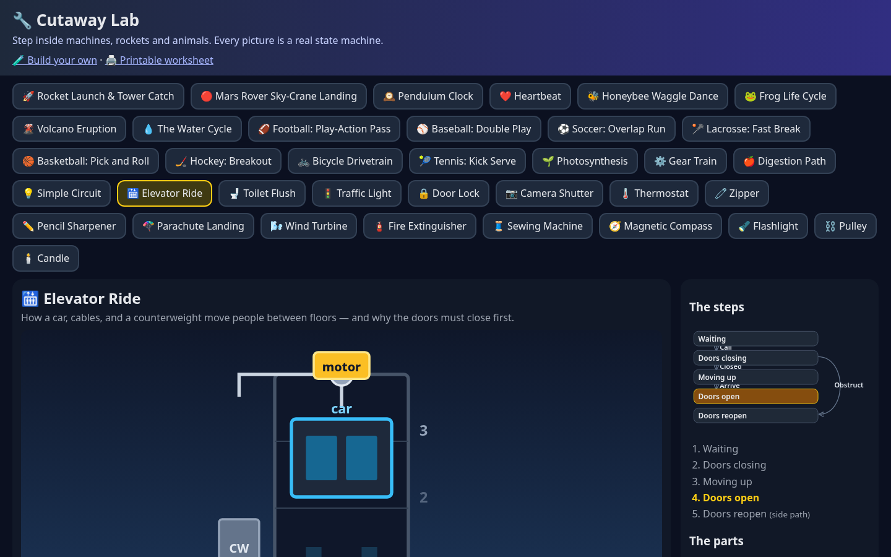 |
| 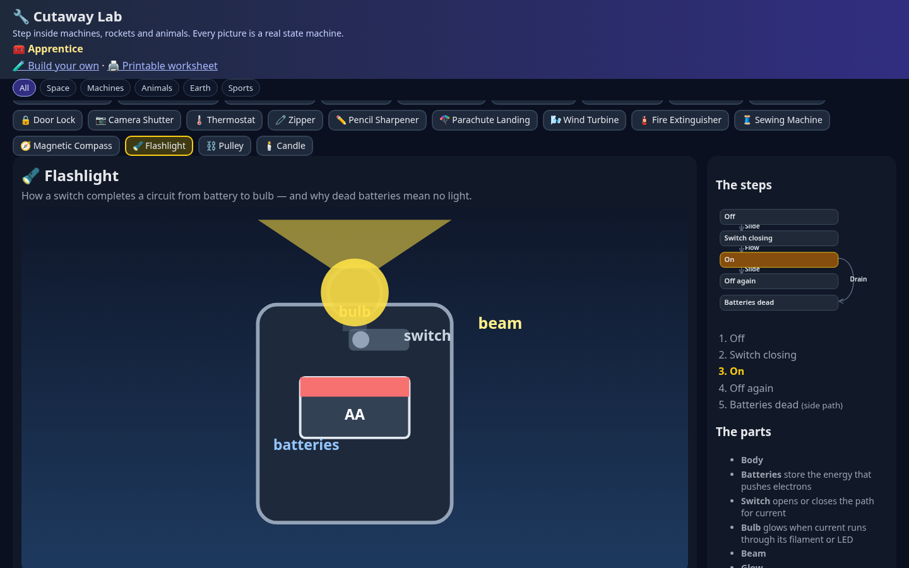 | 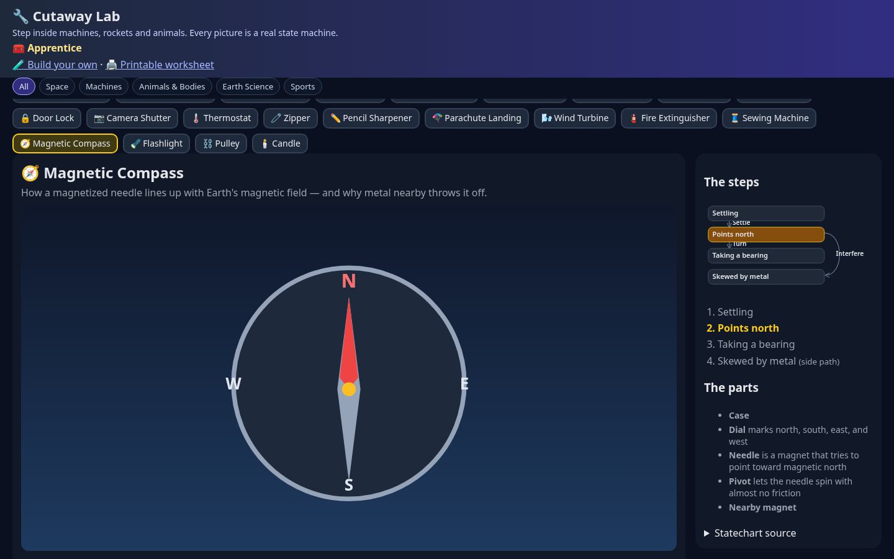 |
| 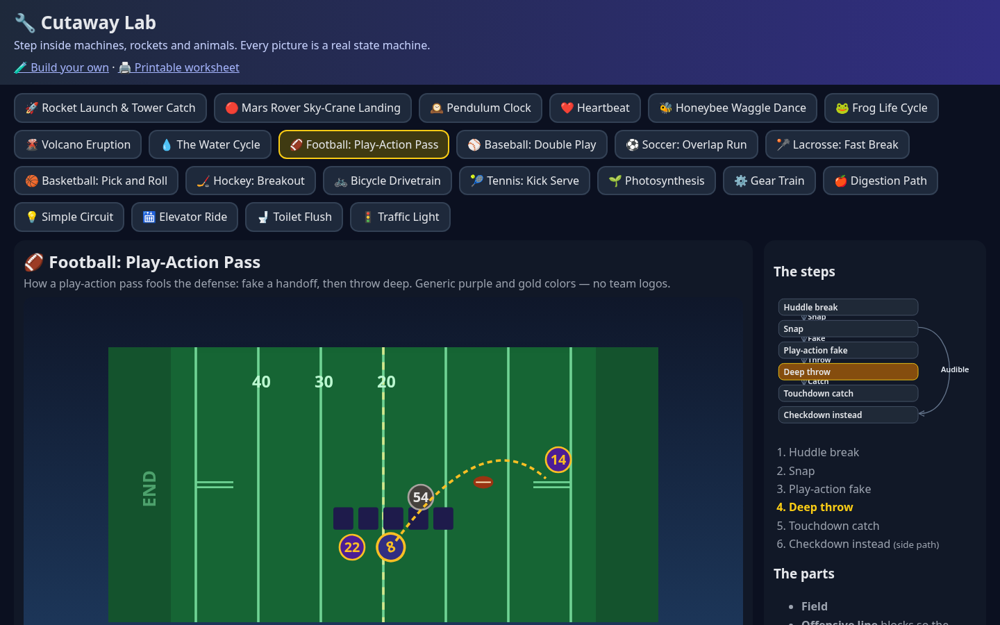 | 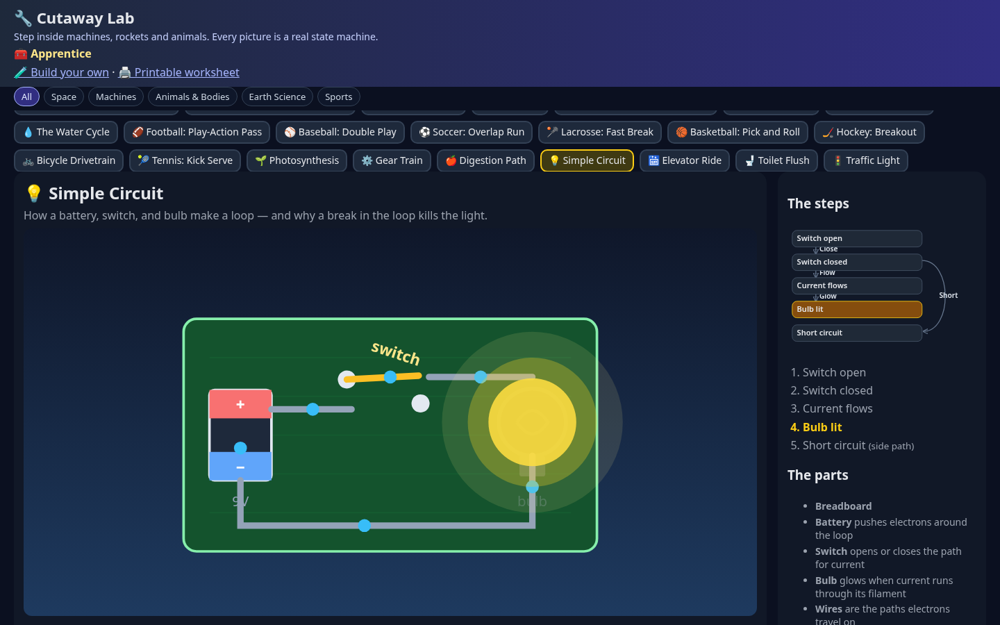 |

Phone: 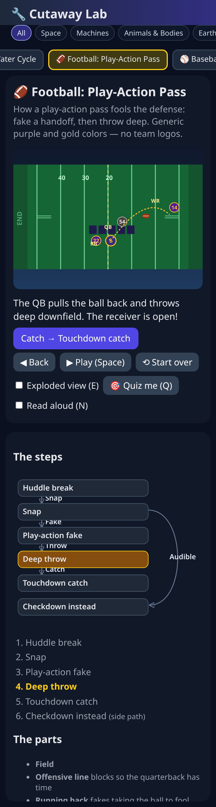

Regenerate the GIF: `node scripts/record-gif.js` (needs ffmpeg) or Demo Director.

## Narrated videos

```bash
npm run narrate                 # all machines → narrations/<id>-captions.mp4
npm run narrate -- --only bike  # one machine (merges into report.json)
```

## Formal checks

```bash
npm run formal   # JS parity checks vs TLA+ transition tables
npm run tlc      # TLC model check (needs tla2tools.jar)
```

## License

MIT
