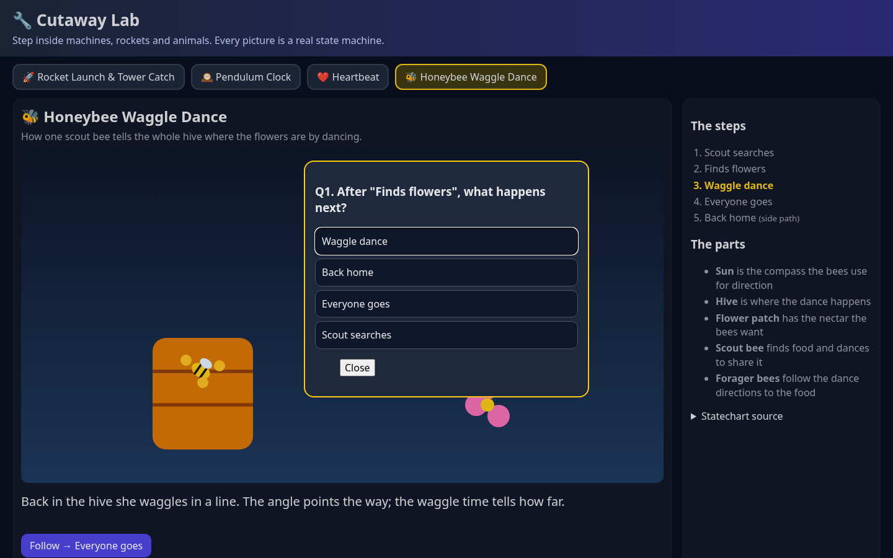

# 🔧 Cutaway Lab

Step inside a rocket launch, a pendulum clock, a beating heart and a honeybee waggle dance. Every animated cutaway is driven by a small **state machine**, so kids can step through how a thing works and the app can check that every machine is sound (every step reachable, nothing gets stuck).


## Quickstart (2 minutes)

```bash
git clone https://github.com/BoydVC/cutaway-lab && cd cutaway-lab
npm start            # http://127.0.0.1:4410  (no install needed: zero runtime deps)
npm test             # unit tests (node:test)
npm i && npx playwright install chromium && npm run e2e   # headless browser tests + screenshots
```

Keys: **Space** play/pause · **→ / ←** step forward/back · **E** exploded view with labels · **Q** quiz.
Deep links: `#starship/staging`, `#clock/tickLeft/x` (x = exploded).

## What's inside

| Machine | Main path | Side path |
|---|---|---|
| 🚀 Rocket Launch & Tower Catch | pad → engines light → liftoff → hot staging → boostback → tower catch | launch scrubbed |
| 🕰️ Pendulum Clock | wound → tick ⇄ tock (loop) | run down |
| ❤️ Heartbeat | fill → top squeeze → big squeeze (loop) | rest |
| 🐝 Honeybee Waggle Dance | search → find flowers → dance → everyone goes | back home |

- `src/engine.js`: the statechart engine: `validate` (unknown targets, unreachable states, livelocks, bad part refs), `step`, `mainPath`, `pose`, `toMermaid`.
- `src/quiz.js`: seeded quizzes built from the machine itself ("what happens next?", "which part does…?").
- `machines/*.js`: one plain-data file per machine. Add one, `npm test` tells you if it is broken.

## Add a machine

```js
export default { id: 'volcano', title: 'Volcano', emoji: '🌋', initial: 'sleep',
  parts: [{ id: 'magma', label: 'Magma', job: 'pushes up from deep below', svg: '<circle cx="200" cy="250" r="30" fill="#f97316"/>', explode: [0, 30] }],
  states: { sleep: { label: 'Asleep', caption: '…', on: { RUMBLE: 'erupt' } }, erupt: { label: 'Eruption', caption: '…', on: {}, parts: { magma: { y: -150 } } } } };
```

Register it in `machines/index.js`.

## Screenshots

| | |
|---|---|
|  |  |
|  |  |

Phone: 

Regenerate the GIF: `node scripts/record-gif.js` (needs ffmpeg).

MIT licensed. Diagrams are simplified for kids; not engineering or medical references.
